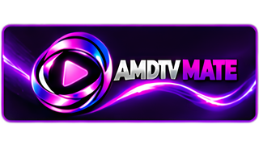
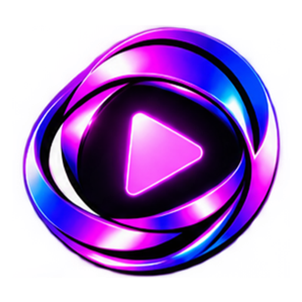
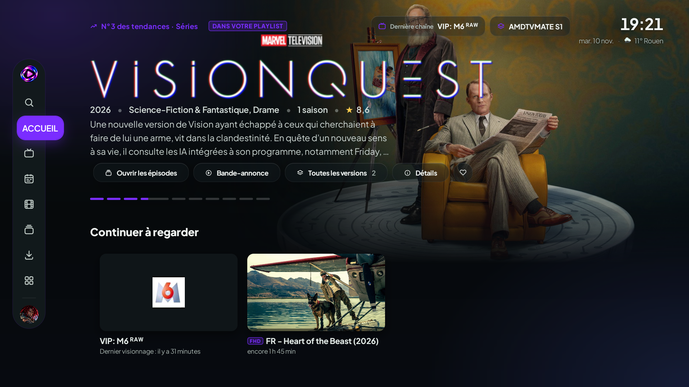
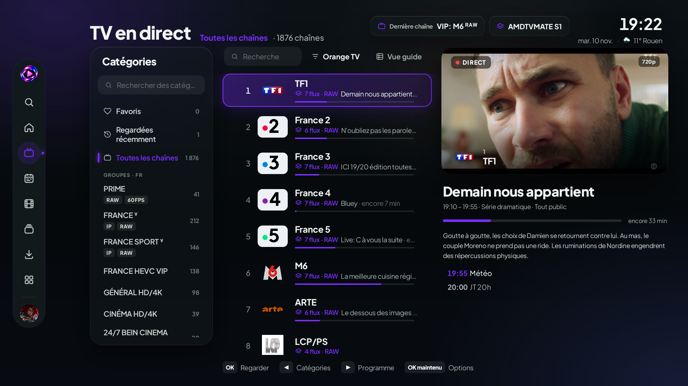
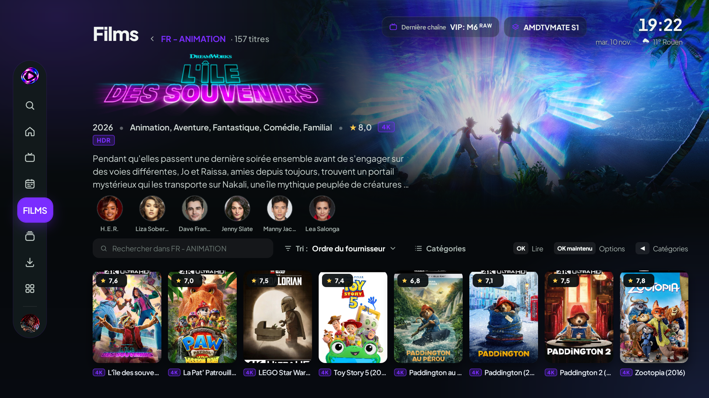
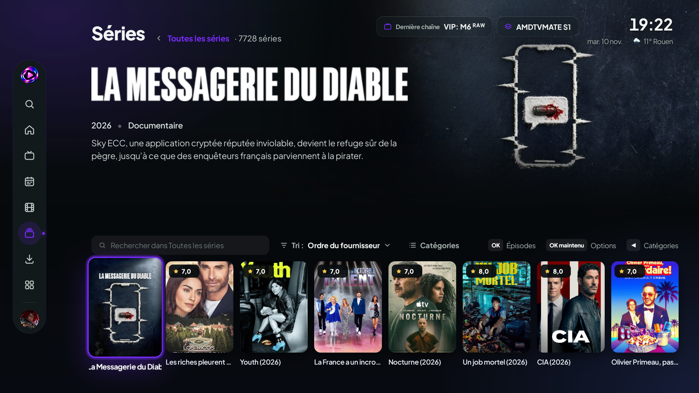
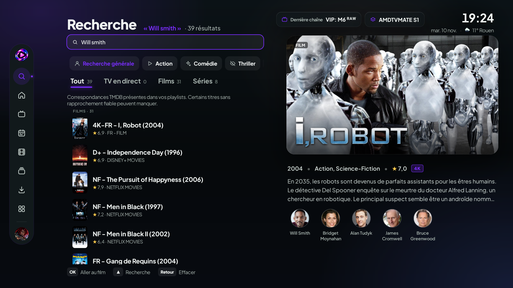
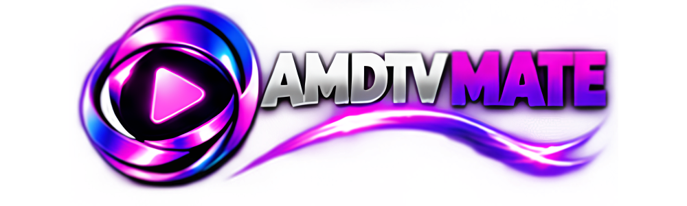

 

### Tout votre univers, sur grand écran.

**Une nouvelle façon de vivre la télévision et le cinéma, pensée pour votre grand écran.**

 

 

[**Découvrir l'interface**](#-une-interface-qui-change-tout) · [**Fonctionnalités**](#-votre-divertissement-sans-compromis) · [**Mises à jour**](#-versions-et-mises-à-jour)

---

## ✦ Bienvenue dans l'univers AMDTVMATE

### Votre divertissement mérite mieux qu'une simple liste de chaînes.

AMDTVMATE est une application multimédia conçue en priorité pour **Android TV**, qui réunit **TV en direct, films et séries** au sein d'une expérience visuelle cohérente.

**Un design cinématographique. Une navigation naturelle à la télécommande. Un univers qui s'adapte à vous.**

L'idée est simple : mettre vos contenus à l'honneur et rendre chaque interaction plus agréable, depuis la page d'accueil jusqu'à la lecture.

---

## ✨ Une interface qui change tout

### Accueil — carrousel et reprises

### TV en direct — catégories, chaînes regroupées et programmes

### Films — présentation cinéma et badges de qualité

### Séries — catalogue et présentation cinéma

### Recherche — titres, genres et acteurs

Captures fournies le 10 novembre 2026, issues de la version de développement. Les contenus visibles dépendent des sources de l’utilisateur.

---

## 📺 Votre divertissement, sans compromis

TV en direct avec catégories et choix des flux, catalogues Films/Séries en présentation cinéma, recherche par titres, genres ou acteurs : les parcours sont conçus pour la télécommande, avec un focus visible et une interface AUTO adaptée à l’espace disponible.

---

## 💜 Une expérience à votre image

<table>
  <tr>
    <td align="center" width="50%">
      
       <strong>Identité AMDTVMATE</strong>
       Un univers visuel reconnaissable, conçu pour le grand écran.
    </td>
    <td align="center" width="50%">
      
       <strong>Thèmes personnalisables</strong>
       Cinq thèmes : Violet, Bleu, Vert, Rouge et Orange.
    </td>
  </tr>
</table>

**Ce qui guide le projet :**

- **Lisibilité d'abord** — interfaces adaptatives, priorité à la clarté.
- **Télécommande avant tout** — navigation directionnelle et focus visibles.
- **Une expérience cinéma** — affiches, visuels et présentation soignée.
- **Personnalisation** — profils, thèmes et préférences.
- **Continuité** — reprise de lecture, sélection des épisodes et téléchargements pour la lecture hors ligne.
- **Fiabilité** — des fonctionnalités testées avant leur mise à disposition publique.

---

## Avancement — 12 novembre 2026

La version 1.0.1 ajoute notamment :

- **Versions d’un même titre** (VF, VOSTFR, 4K…) : bouton Versions, ouverture sur la meilleure version pour la langue et l’écran, reprise et favori partagés.
- **Langue de l’appareil** pour les films et séries, avec sous-titres forcés.
- **Chaînes** : numéros et noms Orange complétés par le plan Free, groupes du fournisseur affichés en entier, séparation d’un flux mal nommé.
- **Accueil** : suggestions « Pour vous », logos assortis au titre avec halo pour les logos sombres.
- **Aide** intégrée et **Paramètres** réorganisés, recherche tolérante aux fautes.
- Connexion AMDTVMATE et synchronisation entre appareils ; les autres types de connexion sont temporairement indisponibles.

Base de la version 1.0.0 :

- TV en direct en trois zones, tri Orange TV, variantes d’une même chaîne accessibles dans un sélecteur et dernier choix de flux mémorisé. Les éditions régionales et décalées restent distinctes.
- **EPG AMDTVMATE — fourni par XMLTV FR**, configuration initiale sans doublon et actualisation selon les réglages. La couverture dépend des correspondances disponibles.
- Recherche par titre, graphies proches, genres et acteurs, limitée aux contenus identifiés dans les playlists ; choix de la personne en cas d’homonymie.
- Accueil organisé autour du carrousel, des favoris et des reprises, avec fonds cinéma liés à la sélection et retours vers la carte d’origine.
- Téléchargement d’épisodes sélectionnés au D-pad, pause/reprise et retours sur le bon élément après lecture.
- Métadonnées suivant la langue de l’appareil par défaut, logos TMDB, années et titres défilants au focus. Les badges utilisent les informations de la source ou les dimensions observées lors d’une lecture normale.
- Installation et profils à halos thématiques, chargements discrets, transitions désactivables et libellés audio/sous-titres enrichis selon les informations du média.

Des contrôles ciblés et des essais manuels ont été réalisés sur un émulateur Android TV. Ils ne remplacent pas une validation générale sur les téléviseurs et boîtiers réels. Les dernières retouches du carrousel ont été validées ; la signature finale, les builds debug/release et le transfert de sauvegarde sans mot de passe vers l’officielle sont validés. La mise à jour 1.0.0 → 1.0.1 sera la première validation de ce parcours sur boîtier réel.

---

## 🚀 Versions et mises à jour

### AMDTVMATE 1.0.1

**Mise à jour pour Android TV ARM 32/64 bits : versions des titres, langue de l’appareil, chaînes Orange/Free, page Aide.**

[Télécharger AMDTVMATE 1.0.1](https://github.com/Amdriggard/AMDTVMATE-Releases/releases/download/v1.0.1/AMDTVMATE-standard-v1.0.1.apk) · [Notes et sources](https://github.com/Amdriggard/AMDTVMATE-Releases/releases/tag/v1.0.1)

Version précédente : [AMDTVMATE 1.0.0](https://github.com/Amdriggard/AMDTVMATE-Releases/releases/tag/v1.0.0)

**Identité Android de distribution :** `com.amdtvmate.app`. La version de développement utilise `com.amdtvmate.app.debug` ; elle est distincte de la distribution signée.

Ce dépôt est dédié à la **présentation officielle** d'AMDTVMATE et à la **distribution des APK stables approuvés**.

Le mécanisme de mise à jour de distribution dispose de contrôles d’identité, de version et de signature. Sa validation réelle entre deux versions signées reste à effectuer. Les builds de développement ne proposent pas l’installation des releases.

**Aucun APK de développement ni identifiant privé ne sera publié ici.**

---

## 🛡️ Transparence et utilisation

AMDTVMATE est un **logiciel de lecture multimédia**. Il ne fournit pas, par lui-même, de droits de diffusion ou d'accès aux contenus. L'utilisateur doit disposer des autorisations appropriées pour les sources qu'il utilise.

Le **code source du projet** est géré séparément ; ce dépôt public présente l’application et ses versions distribuées. Les sources correspondantes et notices GPLv3/tiers sont disponibles avec chaque release. Le dépôt de travail reste privé.

---

### Tout votre univers, sur grand écran.

Conçu pour Android TV · Pensé pour le grand écran · En évolution constante

  

[**Voir les versions**](https://github.com/Amdriggard/AMDTVMATE-Releases/releases)

### Sauvegardes

Sauvegarde complète protégée par mot de passe (recommandée), ou sans mot de passe après avertissement. Cette dernière contient les accès enregistrés : conserver le fichier privé.
