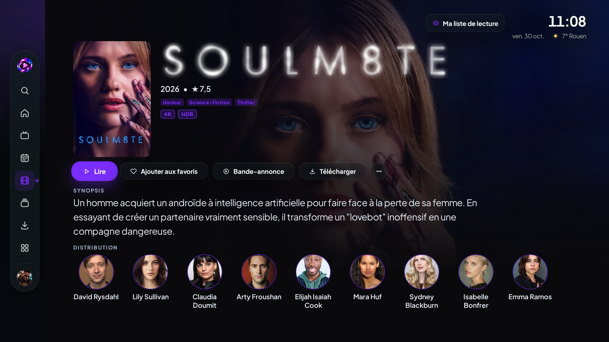
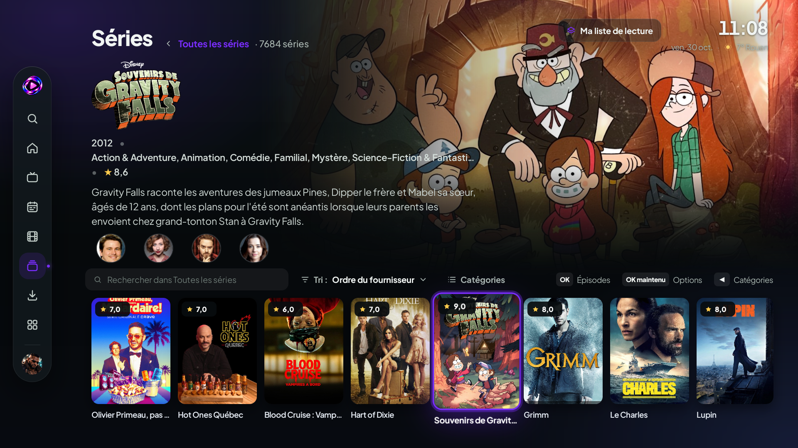
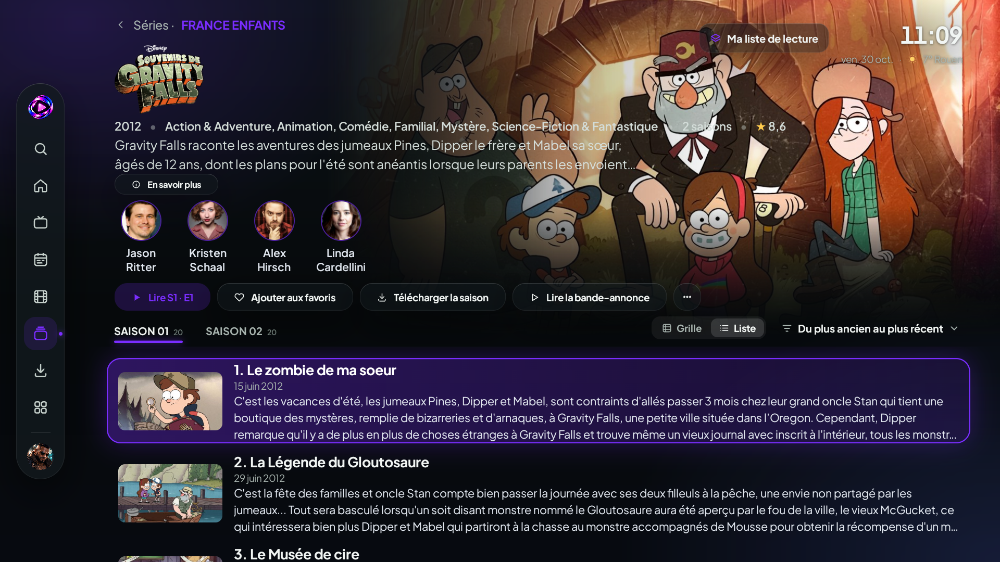

 

### Vos contenus. Votre univers. Votre liberté.

**Une nouvelle façon de vivre la télévision et le cinéma, pensée pour votre grand écran.**

 

 

[**Découvrir l'interface**](#-une-interface-qui-change-tout) · [**Fonctionnalités**](#-votre-divertissement-sans-compromis) · [**Mises à jour**](#-versions-et-mises-à-jour)

---

## ✦ Bienvenue dans l'univers AMDTVMATE

### Votre divertissement mérite mieux qu'une simple liste de chaînes.

AMDTVMATE est une application multimédia conçue en priorité pour **Android TV**, qui réunit **TV en direct, films et séries** au sein d'une expérience visuelle cohérente.

**Un design cinématographique. Une navigation naturelle à la télécommande. Un univers qui s'adapte à vous.**

L'idée est simple : mettre vos contenus à l'honneur et rendre chaque interaction plus agréable, depuis la page d'accueil jusqu'à la lecture.

---

## ✨ Une interface qui change tout

  
  Accueil AMDTVMATE — aperçu de développement

 

**Une identité visuelle forte.** Une palette violet profond, des accents lumineux, des affiches mises en valeur et des espaces conçus pour la lecture sur téléviseur.

**Une interface intelligente.** Le principe du **mode AUTO** vise à adapter les tailles, espacements et éléments visibles à la place réellement disponible, sans sacrifier la lisibilité ni le contrôle à la télécommande.

---

## 📺 Votre divertissement, sans compromis

### 01 — La télévision en direct, autrement

  

 

Accédez à votre univers TV grâce à une navigation pensée pour le quotidien : **groupes de chaînes, favoris, guide des programmes et changement de chaîne à la télécommande**. L'objectif : passer moins de temps dans les menus et davantage de temps devant vos programmes.

### 02 — Les films prennent une autre dimension

  
    
  

 

Parcourez un catalogue d'affiches et découvrez des **fiches immersives** : présentation, synopsis, distribution, informations du film et accès aux actions disponibles. Une expérience inspirée de l'univers du cinéma, sans perdre la simplicité d'un lecteur TV.

### 03 — Les séries, épisode après épisode

  
    
  

 

Retrouvez **saisons, épisodes et détails** dans une présentation pensée pour les longues soirées séries. La navigation et les parcours de sélection sont travaillés pour rester accessibles au **D-pad**, sans gestes tactiles obligatoires.

> Les captures montrent une version de développement. L'apparence et la disponibilité de certaines fonctions peuvent encore évoluer avant la première publication.

---

## 💜 Une expérience à votre image

<table>
  <tr>
    <td align="center" width="50%">
      
       <strong>Identité AMDTVMATE</strong>
       Un univers visuel reconnaissable, conçu pour le grand écran.
    </td>
    <td align="center" width="50%">
      
       <strong>Thèmes personnalisables</strong>
       Violet par défaut et d'autres ambiances colorées prévues.
    </td>
  </tr>
</table>

**Ce qui guide le projet :**

- **Lisibilité d'abord** — interfaces adaptatives, priorité à la clarté.
- **Télécommande avant tout** — navigation directionnelle et focus visibles.
- **Une expérience cinéma** — affiches, visuels et présentation soignée.
- **Personnalisation** — profils, thèmes et préférences.
- **Continuité** — reprise de lecture et parcours de téléchargement en développement.
- **Fiabilité** — des fonctionnalités testées avant leur mise à disposition publique.

---

## 🚀 Versions et mises à jour

### Première version stable : à venir

**AMDTVMATE est actuellement en développement. Aucun APK stable n'a encore été publié.**

Ce dépôt est dédié à la **présentation officielle** d'AMDTVMATE et, à terme, à la **distribution des APK stables approuvés**.

Le mécanisme de mise à jour intégré à l'application est **prévu**, mais **pas encore opérationnel**. Sa conception doit notamment prendre en compte :

- la signature cohérente des versions Android ;
- la vérification de l'intégrité des fichiers distribués ;
- la comparaison des versions pour empêcher les retours arrière accidentels ;
- la confirmation de l'installation par Android ;
- la préservation des profils, réglages et autres données compatibles.

**Aucun APK de développement ni identifiant privé ne sera publié ici.**

---

## 🛡️ Transparence et utilisation

AMDTVMATE est un **logiciel de lecture multimédia**. Il ne fournit pas, par lui-même, de droits de diffusion ou d'accès aux contenus. L'utilisateur doit disposer des autorisations appropriées pour les sources qu'il utilise.

Le **code source du projet** est géré séparément ; ce dépôt public est consacré à sa présentation et à ses futures versions distribuées. Les notices de licence et obligations relatives aux composants tiers seront respectées lors de la publication.

---

### Vos contenus. Votre univers. Votre liberté.

Conçu pour Android TV · Pensé pour le grand écran · En évolution constante

  

[**Voir les futures versions**](https://github.com/Amdriggard/AMDTVMATE-Releases/releases)

