

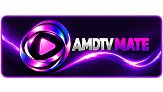

 

### Tout votre univers, sur grand écran.

**Une nouvelle façon de vivre la télévision et le cinéma, pensée pour votre grand écran.**

 

 

[**Téléphone et tablette**](#-téléphone-et-tablette) · [**Découvrir l'interface**](#-une-interface-qui-change-tout) · [**Fonctionnalités**](#-votre-divertissement-sans-compromis) · [**Mises à jour**](#-versions-et-mises-à-jour)

---

## ✦ Bienvenue dans l'univers AMDTVMATE

### Votre divertissement mérite mieux qu'une simple liste de chaînes.

AMDTVMATE est une application multimédia conçue en priorité pour **Android TV**, qui réunit **TV en direct, films et séries** au sein d'une expérience visuelle cohérente.

**Un design cinématographique. Une navigation naturelle à la télécommande. Un univers qui s'adapte à vous.**

L'idée est simple : mettre vos contenus à l'honneur et rendre chaque interaction plus agréable, depuis la page d'accueil jusqu'à la lecture.

---

## ⚡ Installer en une minute

| 📺 TV et box Android | 📱 Téléphone et tablette |
|:---:|:---:|
| Code Downloader **`3898647`** | Code Downloader **`1317982`** |
| [aftv.news/3898647](https://aftv.news/3898647) | [aftv.news/1317982](https://aftv.news/1317982) |
| Android TV · Google TV · Fire TV | Android 8.0 ou plus |

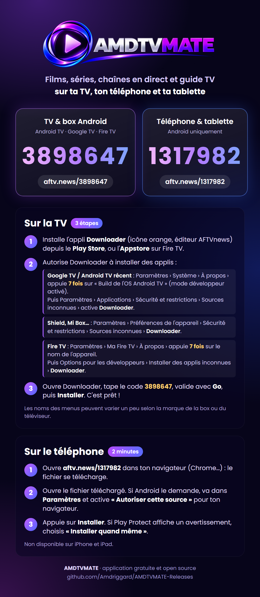

**Sur la TV :** installez l'appli **Downloader** (AFTVnews) depuis le Play Store ou l'Appstore, autorisez-la dans *Sources inconnues*, puis tapez le code **3898647**.

**Sur le téléphone :** ouvrez **aftv.news/1317982** dans le navigateur, puis installez le fichier téléchargé.

Les codes pointent vers la TV 1.1.2 et le mobile 1.2.1 (préversion).

---

## 📱 Téléphone et tablette

### AMDTVMATE arrive sur vos écrans tactiles.

**La même identité, la même richesse, repensées pour le doigt.**

 

Préversion · Android 8.0 ou plus · ARM 32/64 bits · [Notes, sources et empreintes](https://github.com/Amdriggard/AMDTVMATE-Releases/releases/tag/v1.2.1)

 

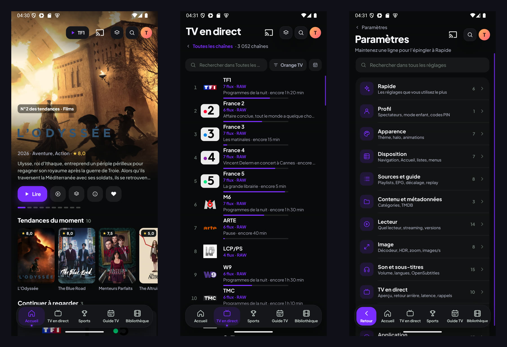

<table>
  <tr>
    <td width="50%">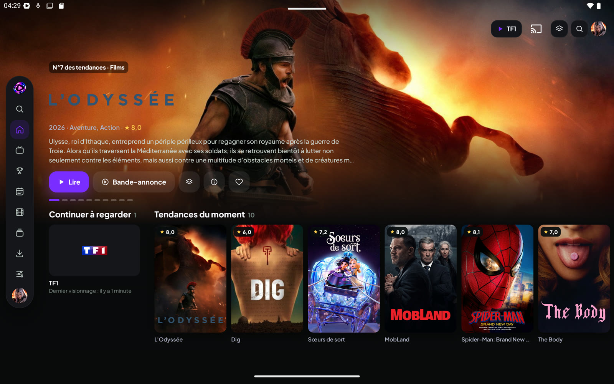 <strong>Accueil</strong> — tendances et reprises sur une seule page</td>
    <td width="50%">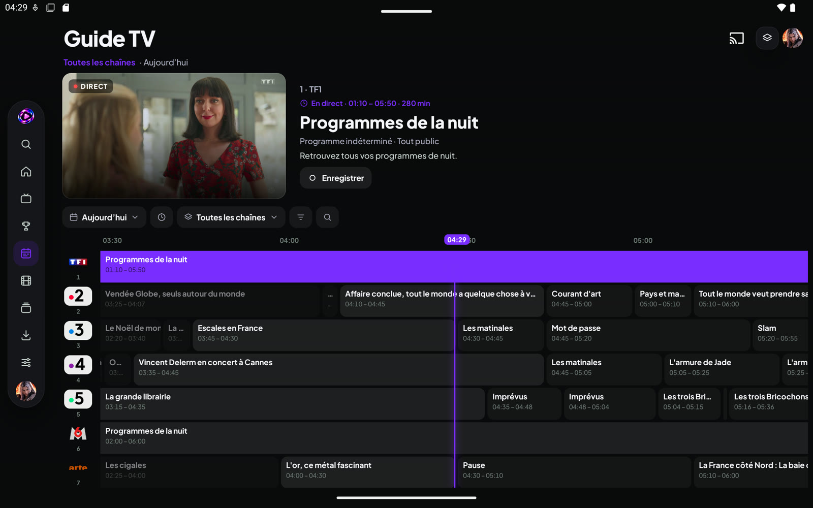 <strong>Guide TV</strong> — grille et aperçu en direct</td>
  </tr>
  <tr>
    <td>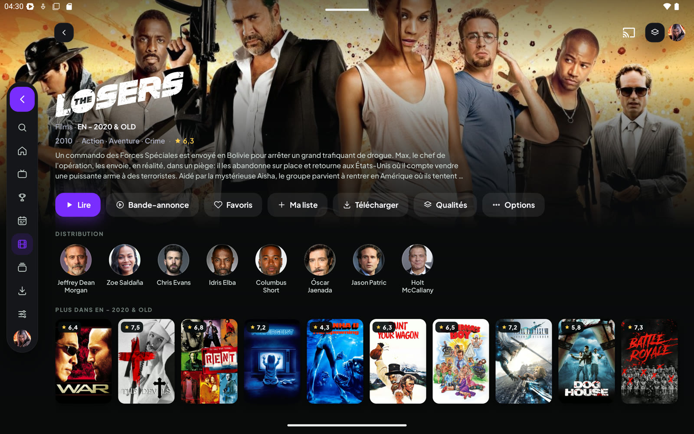 <strong>Fiches</strong> — actions, distribution et suggestions</td>
    <td>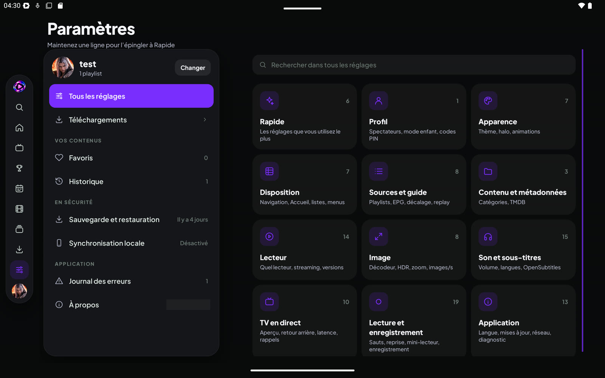 <strong>Paramètres</strong> — tout est rangé et se cherche</td>
  </tr>
</table>

| | Téléphone | Tablette |
|---|---|---|
| **Navigation** | Barre du bas et bouton Retour | Colonne à gauche |
| **Accueil** | Défilement fluide | Pages pleines |
| **Catalogues** | Affiches, grille ou liste | Grille et fiche côte à côte |
| **Réglages** | Pages claires avec aide | Deux panneaux avec explications |

**Installer :** téléchargez l'APK, ouvrez-le, autorisez l'installation, puis connectez-vous avec votre compte AMDTVMATE. Sur téléviseur, gardez la **version Android TV 1.1.2** ci-dessous.

Captures du 25 novembre 2026 (émulateurs). Les contenus visibles dépendent des sources de l'utilisateur.

---

## ✨ Une interface qui change tout

### Accueil — carrousel et reprises

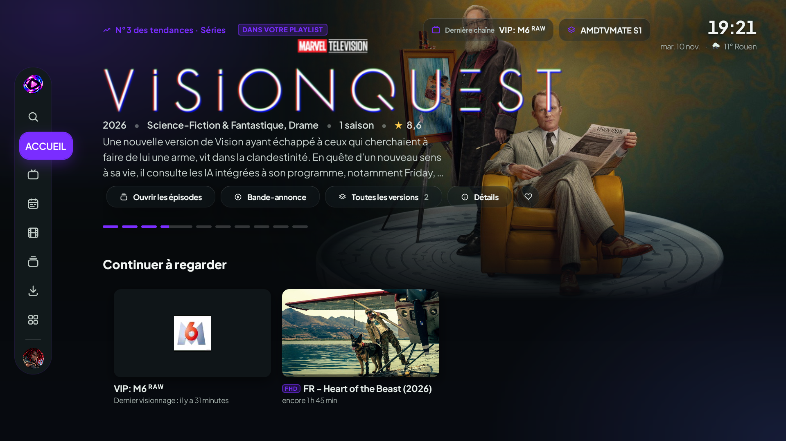

### TV en direct — catégories, chaînes regroupées et programmes

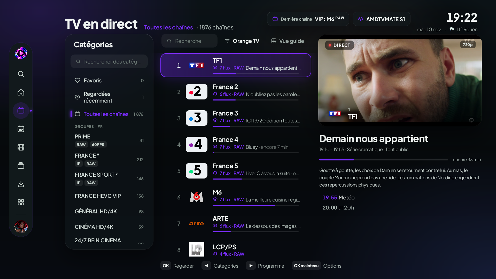

### Films — présentation cinéma et badges de qualité

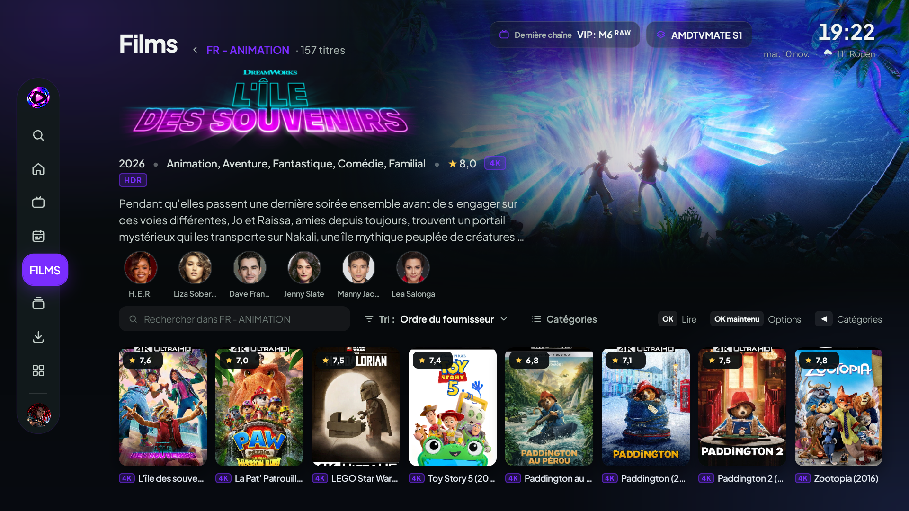

### Séries — catalogue et présentation cinéma

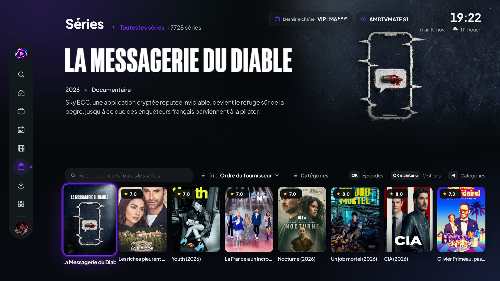

### Recherche — titres, genres et acteurs

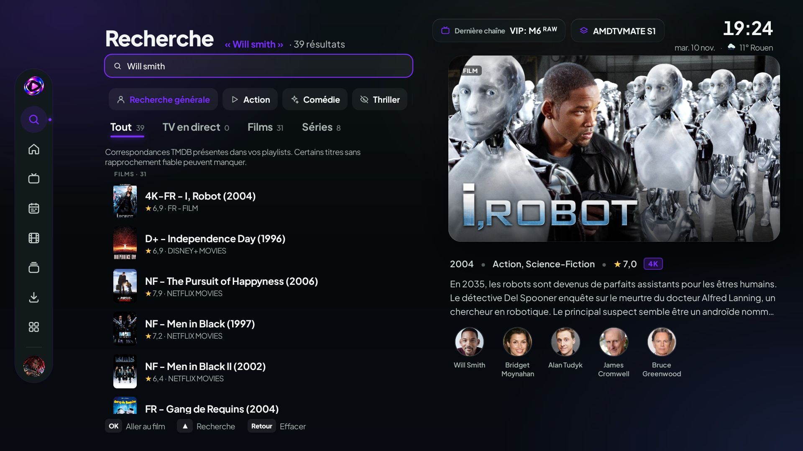

Captures fournies le 10 novembre 2026, issues de la version de développement. Les contenus visibles dépendent des sources de l’utilisateur.

---

## 📺 Votre divertissement, sans compromis

TV en direct avec catégories et choix des flux, catalogues Films/Séries en présentation cinéma, recherche par titres, genres ou acteurs : les parcours sont conçus pour la télécommande, avec un focus visible et une interface AUTO adaptée à l’espace disponible.

---

## 💜 Une expérience à votre image

<table>
  <tr>
    <td align="center" width="50%">
      
       <strong>Identité AMDTVMATE</strong>
       Un univers visuel reconnaissable, conçu pour le grand écran.
    </td>
    <td align="center" width="50%">
      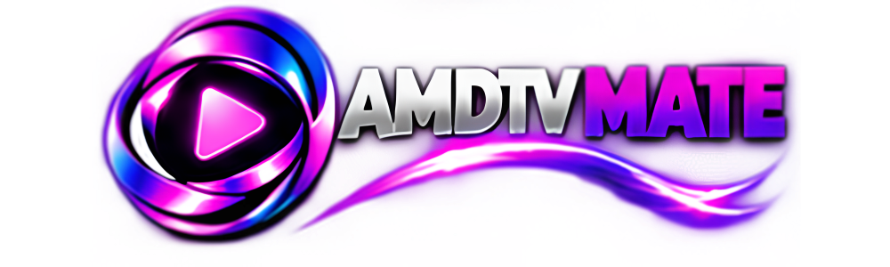
       <strong>Thèmes personnalisables</strong>
       Cinq thèmes : Violet, Bleu, Vert, Rouge et Orange.
    </td>
  </tr>
</table>

**Ce qui guide le projet :**

- **Lisibilité d'abord** — interfaces adaptatives, priorité à la clarté.
- **Télécommande avant tout** — navigation directionnelle et focus visibles.
- **Une expérience cinéma** — affiches, visuels et présentation soignée.
- **Personnalisation** — profils, thèmes et préférences.
- **Continuité** — reprise de lecture, sélection des épisodes et téléchargements pour la lecture hors ligne.
- **Fiabilité** — des fonctionnalités testées avant leur mise à disposition publique.

---

## Avancement — 25 novembre 2026

La version 1.1.2 ajoute notamment :

- **Démarrage et fluidité** : Accueil, Direct et Guide TV plus rapides ; boîtiers modestes plus fluides, avec bandes-annonces et animations.
- **Films et Séries** : en vue Grille, une carte présente le titre choisi ; Auto choisit bien la version 4K.
- **Accueil** : Ma liste et Favoris réunissent films et séries, fond qui suit l'affiche choisie.
- **Sous-titres** : ASS, SRT, SUB et autres formats texte mieux pris en charge, pistes nommées clairement.
- **Sports** : un match s'ouvre sur la première chaîne trouvée.
- **Apparence** : fonds sans paliers de couleur, logos de titres noirs affichés en clair, menus plus sobres.

La version 1.1.1 avait ajouté :

- **Sports** : rubrique dans le menu et rangée sur l'Accueil, alertes, championnats suivis et chaîne retenue par compétition, noms en français.
- **Lecture** : autre version lancée automatiquement quand le téléviseur ne sait pas afficher le Dolby Vision, changement de langue audio sans coupure, reprise des séries à l'épisode vu le plus loin.
- **Catalogues** : vue Grille pour Films et Séries.
- **Profils** : catégories verrouillables par code PIN et code des Paramètres par profil.
- **Synchronisation entre TV** : profils, playlists, favoris et réglages partagés, suppressions transmises.
- Paramètres mieux rangés, fenêtres plus compactes, ouverture à la sortie de veille.

La version 1.1.0 avait ajouté :

- **Bandes-annonces** dans le bandeau après 5 secondes sur un film ou une série (catalogues, accueil, fiches), avec le son, et un **mode immersif** qui laisse toute la place à la vidéo.
- **Fiches** films et séries au même modèle, page Épisodes à part, affiches et résumés en français.
- **Accueil** : Ma liste, rangée et pastille « Nouveaux épisodes », « Continuer à regarder » qui propose l'épisode suivant.
- **Épisode suivant** qui apprend quand enchaîner, reprises partagées entre TV associées, sauvegarde automatique chaque semaine.
- **Fluidité** nettement améliorée et nouveau **fond noir profond** à la couleur du thème.
- Connexion AMDTVMATE et synchronisation entre appareils ; les autres types de connexion restent temporairement indisponibles.

La version 1.0.1 avait ajouté les versions d'un même titre, la langue de l'appareil, les chaînes Orange/Free, l'aide intégrée et des paramètres réorganisés.

Base de la version 1.0.0 :

- TV en direct en trois zones, tri Orange TV, variantes d’une même chaîne accessibles dans un sélecteur et dernier choix de flux mémorisé. Les éditions régionales et décalées restent distinctes.
- **EPG AMDTVMATE — fourni par XMLTV FR**, configuration initiale sans doublon et actualisation selon les réglages. La couverture dépend des correspondances disponibles.
- Recherche par titre, graphies proches, genres et acteurs, limitée aux contenus identifiés dans les playlists ; choix de la personne en cas d’homonymie.
- Accueil organisé autour du carrousel, des favoris et des reprises, avec fonds cinéma liés à la sélection et retours vers la carte d’origine.
- Téléchargement d’épisodes sélectionnés au D-pad, pause/reprise et retours sur le bon élément après lecture.
- Métadonnées suivant la langue de l’appareil par défaut, logos TMDB, années et titres défilants au focus. Les badges utilisent les informations de la source ou les dimensions observées lors d’une lecture normale.
- Installation et profils à halos thématiques, chargements discrets, transitions désactivables et libellés audio/sous-titres enrichis selon les informations du média.

Des contrôles ciblés et des essais manuels ont été réalisés sur un émulateur Android TV. Ils ne remplacent pas une validation générale sur les téléviseurs et boîtiers réels. Les dernières retouches du carrousel ont été validées ; la signature finale, les builds debug/release et le transfert de sauvegarde sans mot de passe vers l’officielle sont validés. La mise à jour 1.0.1 → 1.1.0 par l’APK a été validée sur émulateur Android TV, données conservées. La 1.1.1 et la 1.1.2 ont été essayées sur NVIDIA Shield, Xiaomi Mi Box S et émulateur Android TV.

---

## 🚀 Versions et mises à jour

### AMDTVMATE 1.1.2

**Mise à jour pour Android TV ARM 32/64 bits : fluidité, vue Grille complétée, sous-titres, Accueil et apparence.**

[Télécharger AMDTVMATE 1.1.2](https://github.com/Amdriggard/AMDTVMATE-Releases/releases/download/v1.1.2/AMDTVMATE-standard-v1.1.2.apk) · [Notes et sources](https://github.com/Amdriggard/AMDTVMATE-Releases/releases/tag/v1.1.2)

**Boîtiers sous Android 9 encore en 1.0.1 (par exemple Mi Box S)** : la mise à jour depuis l'application peut s'arrêter sur « La mise à jour n'a pas été téléchargée entièrement ». Le fichier est bien reçu, mais la 1.0.1 ne parvient pas à lire sa signature sous Android 9 et le refuse. Installez une fois AMDTVMATE-standard-v1.1.2.apk à la main, par-dessus la 1.0.1 : vos données sont conservées. Depuis la 1.1.0, ce contrôle est corrigé pour les mises à jour suivantes.

Versions précédentes : [AMDTVMATE 1.1.1](https://github.com/Amdriggard/AMDTVMATE-Releases/releases/tag/v1.1.1) · [AMDTVMATE 1.1.0](https://github.com/Amdriggard/AMDTVMATE-Releases/releases/tag/v1.1.0) · [AMDTVMATE 1.0.1](https://github.com/Amdriggard/AMDTVMATE-Releases/releases/tag/v1.0.1) · [AMDTVMATE 1.0.0](https://github.com/Amdriggard/AMDTVMATE-Releases/releases/tag/v1.0.0)

**Identité Android de distribution :** `com.amdtvmate.app`. La version de développement utilise `com.amdtvmate.app.debug` ; elle est distincte de la distribution signée.

Ce dépôt est dédié à la **présentation officielle** d'AMDTVMATE et à la **distribution des APK stables approuvés**.

Le mécanisme de mise à jour de distribution dispose de contrôles d’identité, de version et de signature. Sa validation réelle entre deux versions signées reste à effectuer. Les builds de développement ne proposent pas l’installation des releases.

**Aucun APK de développement ni identifiant privé ne sera publié ici.**

---

## 🛡️ Transparence et utilisation

AMDTVMATE est un **logiciel de lecture multimédia**. Il ne fournit pas, par lui-même, de droits de diffusion ou d'accès aux contenus. L'utilisateur doit disposer des autorisations appropriées pour les sources qu'il utilise.

Le **code source du projet** est géré séparément ; ce dépôt public présente l’application et ses versions distribuées. Les sources correspondantes et notices GPLv3/tiers sont disponibles avec chaque release. Le dépôt de travail reste privé.

---

### Tout votre univers, sur grand écran.

Android TV · Téléphone · Tablette · En évolution constante

  

[**Voir les versions**](https://github.com/Amdriggard/AMDTVMATE-Releases/releases)

### Sauvegardes

Sauvegarde complète protégée par mot de passe (recommandée), ou sans mot de passe après avertissement. Cette dernière contient les accès enregistrés : conserver le fichier privé.
